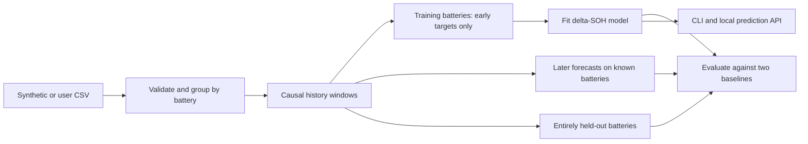

# Battery Health Forecast Service

**Forecast a battery's capacity ten cycles ahead from its recent measured history.** This repository connects a causal feature pipeline, leakage-aware evaluation, transparent baselines, a small machine-learning model, and a local prediction API.

An independent portfolio project by **Mahou Mehdi**. The included data are **synthetic** and the reported metrics describe that synthetic experiment. This is not employer code, a validated battery-management system, or a claim about past industrial performance.

## What is included

- Deterministic generation of 30 synthetic battery traces with different degradation rates, knee points, temperature patterns, charge rates, and sensor noise.
- CSV loading with explicit units, duplicate detection, and measurement validation.
- Forecast features derived exclusively from the twelve cycles available at the forecast origin.
- A persistence baseline, a linear-trend baseline, and gradient boosting trained to predict the **change** in state of health (SOH).
- Separate evaluation of future periods on known batteries and completely unseen batteries.
- A CLI, FastAPI service, example request/response, reproducible metrics, and meaningful correctness tests.



## Quick start

Python **3.12** is tested. No GPU, account, external dataset, or API key is needed.

```bash
git clone https://github.com/Mahou-Mehdi/battery-health-service.git
cd battery-health-service
python -m venv .venv
```

Activate with `.venv\Scripts\Activate.ps1` in Windows PowerShell, or `source .venv/bin/activate` on macOS/Linux. Then run:

```bash
python -m pip install -r requirements.txt
python -m battery_health.cli demo
python -m battery_health.cli predict
python -m unittest discover -s tests -v
```

The demo generates 5,400 synthetic measurements, trains the model, evaluates both test protocols, and writes:

- `artifacts/synthetic-batteries.csv` — generated demo data.
- `artifacts/model.joblib` — locally trained model plus metadata.
- `results/demo-metrics.json` and `.md` — detailed measured results.
- `examples/predict-request.json` and `predict-response.json` — a runnable forecast example.

The generated data and model are ignored by Git. The small result and request/response files are checked in. The model is deliberately not trained on the test data after evaluation; the API serves the same evaluated model.

## Try the API

After running the demo:

```bash
python -m uvicorn battery_health.api:app --host 127.0.0.1 --port 8000
```

Open **http://127.0.0.1:8000/docs** for interactive documentation. Endpoints:

| Endpoint | Purpose |
|---|---|
| `GET /health` | Process status and whether a model is loaded |
| `GET /model` | Training source, feature order, forecast horizon, split and version metadata |
| `POST /predict` | Forecast from measured history for one battery |

In another terminal, macOS/Linux:

```bash
curl -X POST http://127.0.0.1:8000/predict -H "Content-Type: application/json" --data-binary @examples/predict-request.json
```

Windows PowerShell:

```powershell
Invoke-RestMethod -Method Post -Uri http://127.0.0.1:8000/predict -ContentType 'application/json' -InFile examples/predict-request.json
```

Set the `BATTERY_MODEL` environment variable to select another locally trained model; the default is `artifacts/model.joblib`. Restart the server after changing the model. If no model exists, `/health` reports `model_ready: false` and prediction returns HTTP 503 with the training command.

## Measured demo results

Seed 42; 30 batteries × 180 cycles; 12-cycle histories; 10-cycle horizon. The six held-out batteries never enter training. Hyperparameters are fixed in code; these test sets were not used for model selection.

**SOH = capacity / nominal capacity.** Errors below are **percentage points of SOH**: 0.320 pp means an absolute error of 0.00320, not 32%.

| Evaluation | Method | MAE (pp) | RMSE (pp) |
|---|---|---:|---:|
| Later cycles on known batteries | Persistence | 1.493 | 1.554 |
| Later cycles on known batteries | Linear trend | **0.250** | **0.314** |
| Later cycles on known batteries | Gradient boosting | 0.320 | 0.410 |
| Unseen batteries | Persistence | 0.962 | 1.074 |
| Unseen batteries | Linear trend | 0.238 | 0.298 |
| Unseen batteries | Gradient boosting | **0.226** | **0.296** |

The ML model slightly improves the unseen-battery MAE, but **linear extrapolation is stronger on the later-cycle test**. This is a useful result: adding a model does not automatically improve extrapolation. Neither test establishes performance on physical batteries. Full per-battery errors, split IDs, configuration, input fingerprint, library versions, and training time are in [the raw result file](results/demo-metrics.json).

## How leakage is prevented

1. Entire battery IDs are deterministically selected for the unseen-battery test before fitting.
2. For each remaining battery, a cutoff is placed at 70% of its available forecasting span.
3. A window may enter training only if its **target cycle is at or before that cutoff**.
4. A window may enter the temporal test only if its **forecast origin is after the cutoff**. Boundary-crossing windows are discarded.
5. Features use only measurements available at the forecast origin. Battery ID is not a model feature. No scaling or imputation is fitted on a test set.

Past context may overlap previously observed history; that is legitimate for a rolling future forecast. The future target cannot enter its own feature window or a training target beyond the cutoff. The test suite checks these boundaries and verifies that changing future capacities cannot change earlier features.

The known-battery and unseen-battery tests answer different questions and are reported separately. Windows overlap within each test battery, so the rows are correlated. We report per-battery errors and an unweighted macro average in JSON, but do not treat every overlapping window as an independent statistical trial.

## Use your own CSV

Use measurements you have permission to publish or process. Keep private data outside version control (`data/private/` is ignored). Required columns:

| Column | Unit / meaning |
|---|---|
| `battery_id` | Stable string identifying one battery |
| `cycle` | Nonnegative integer charge/discharge cycle index |
| `capacity_ah` | Measured capacity in ampere-hours at that cycle |
| `nominal_capacity_ah` | Fixed reference capacity for that battery, in ampere-hours |
| `temperature_c` | Representative cycle temperature in degrees Celsius |
| `resistance_mohm` | Measured internal resistance in milliohms |
| `charge_rate_c` | Charging current expressed as a C-rate |

Every numeric value must be finite. Capacities, resistance, and charge rate must be positive. Nominal capacity must remain constant within a battery. Duplicate `(battery_id, cycle)` pairs are rejected. Capacity above 120% of nominal is rejected as a likely unit/input error.

```bash
python -m battery_health.cli train --csv data/private/batteries.csv --output artifacts/real-data --report results/real-data-metrics.json
python -m battery_health.cli predict --model artifacts/real-data/model.joblib --history path/to/history.json
```

At least five batteries with sufficient valid windows are required. The last twelve input cycles must be consecutive; training windows with history gaps are excluded. The target must exist at exactly `origin + horizon`—missing cycles never silently change the horizon. The CLI supports `--window`, `--horizon`, and `--seed` for training and demo generation.

A request is a JSON object with a `readings` array containing the CSV fields above. See the [complete sample request](examples/predict-request.json). Provide past/current measurements only. Current measured capacity is intentionally used as an input; this is a **future-capacity forecasting** problem, not SOH estimation from raw voltage/current alone.

## Model and synthetic data

The toy generator combines battery-specific linear fade, a later accelerating term, ambient temperature and charge-rate variation, and measurement noise. Resistance increases as simulated capacity fades. It is an original software test fixture, not a chemistry-calibrated simulator or a public research dataset.

Eight features summarize cycle age, current SOH, recent SOH slope and variation, mean temperature, latest resistance, resistance slope, and mean charge rate. `HistGradientBoostingRegressor` fits future SOH change. Adding that predicted change to current SOH gives the forecast. Baselines use current SOH unchanged or extrapolate the recent fitted slope.

Predictions are not forcibly clipped to hide implausible outputs. The system has no uncertainty intervals, out-of-distribution detector, authentication, rate limiting, fleet monitoring, or real-battery validation. The server binds locally in the documented command. It is an engineering demonstration; deployment needs additional validation and operational work.

Model files use joblib/pickle serialization. Load only artifacts you generated or otherwise trust; never load a model uploaded by an untrusted user. The API does not accept model paths from requests.

## Repository guide

| Path | Purpose |
|---|---|
| `battery_health/data.py` | CSV validation and synthetic generation |
| `battery_health/features.py` | Causal windows and evaluation splits |
| `battery_health/model.py` | Training, baselines, prediction, metrics |
| `battery_health/cli.py` | Demo, CSV training, generation and prediction commands |
| `battery_health/api.py` | Typed HTTP input and local model serving |
| `tests/test_pipeline.py` | Leakage boundaries, causal features, API validation and reproducibility |
| `results/` | Measured synthetic experiment |
| `examples/` | Example input and actual prediction |

## Next experiments

Evaluate on a properly licensed real battery dataset, use nested battery-level validation before tuning, add uncertainty calibration using a separate validation group, and test transfer across cell chemistry and operating conditions. These are future extensions, not features claimed by this version.

## License

[MIT](LICENSE), copyright Mahou Mehdi. All included sample measurements are generated by this repository's original synthetic generator. No third-party or employer battery measurements are included.
